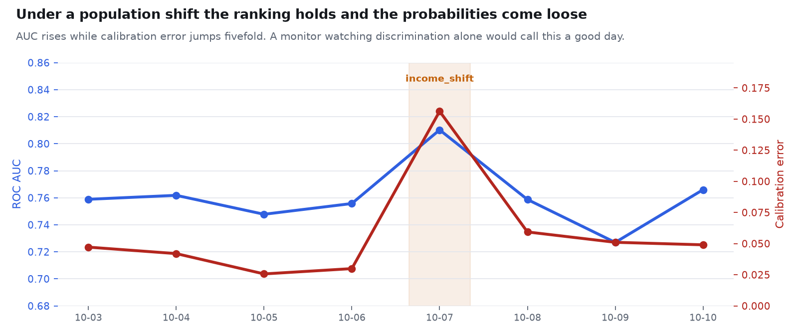

# DataSentinel

**Data quality and ML monitoring for batch pipelines, characterised by the smallest
fault it can actually see.**

[](https://pablowilliams.github.io/datasentinel/)
[](https://github.com/pablowilliams/datasentinel/actions/workflows/ci.yml)
[](LICENSE)

[**Open the dashboard →**](https://pablowilliams.github.io/datasentinel/) ·
[Architecture](docs/architecture.md) ·
[Decision records](#documentation) ·
[Limitations](#limitations)

### In short

DataSentinel watches a daily batch of loan applications: it loads them, checks
them against declared rules, compares the population against a reference window,
scores an approval model on them, and raises incidents that say what was expected
and what arrived.

**It is characterised by the smallest fault it can see, not by its recall.**
Detection floors: duplicates from 0.2% of a batch, missing income from 5%, rows
lost upstream from 30%, a pure population shift only from 15%. That last figure
is a real limitation and it is stated rather than buried.

**The finding worth the click:** under a population shift the model's ranking
survives and its probabilities come loose, so a monitor watching AUC alone
reports a good day while the model approves the wrong people.



Synthetic data throughout, so this is a test of the wiring and not of the world.
Python 3.12, PostgreSQL 17, pandas, SciPy, scikit-learn, 114 tests. No dbt,
FastAPI or Docker yet; see [what is built](#what-is-built-and-what-is-not).

## What it detects, and from how small

Across 720 scenario-days, twelve scenarios over sixty days:

| | |
|---|---|
| Failures detected, by the right category | **480 / 480** |
| False alarms on non-failure days | **3 / 240** (1.3%) |
| False alarms on healthy days | **0 / 60** |
| Precision / recall / F1 | 99.4% / 100% / 99.7% |

Those figures are close to uninformative on their own, and reporting them alone
would be the mistake this project is built to avoid. Recall of 100% against a
fault chosen to be large measures the choice of fault. The honest
characterisation is the smallest fault reliably caught, on at least 90% of days:

| Fault | Reliably caught from | Detection at half that severity |
|---|---|---|
| Duplicate records | **0.2%** of the batch | 100% |
| Invalid values | **0.2%** of rows | 95% at 0.2%, 76% at 0.1% |
| Missing income | **5%** null rate | 62% at 4%, 14% at 3% |
| Rows lost upstream | **30%** of the batch | 81% at 25%, 48% at 20% |
| Population shift, income only | **15%** uplift | 29% at 10%, 10% at 6% |

Read the last row as the real limitation. **A population whose income has moved by
10% is caught on fewer than a third of days.** Anyone relying on this to notice a
gradual shift would be relying on something it cannot do.

The missing-income floor of 5% is not a coincidence: it is the configured
threshold, and detection climbs from 14% to 100% across the three points either
side of it. That is what a correctly calibrated check looks like.

## Run it

Needs PostgreSQL on localhost. `brew services start postgresql@17`, then
`createdb datasentinel`.

`requirements.txt` lists only what the code imports. Packages for work that is
planned but unwritten are in `requirements-planned.txt`, so nobody installs
400MB of dbt, FastAPI and Streamlit to run a test suite that uses none of it.

```bash
make install        # venv and dependencies
make init           # schema plus 90 days of healthy reference data
make demo           # a healthy run, then three different failures
make evaluate       # score detection across every scenario
make sensitivity    # find the smallest fault reliably caught
make test           # 114 tests
```

Model monitoring:

```bash
make train-model    # train the approval classifier on healthy history
make monitor-model  # score recent batches, record to model_metrics
make decay          # does detected drift correspond to model damage?
```

Individual runs:

```bash
.venv/bin/python -m datasentinel.cli scenarios
.venv/bin/python -m datasentinel.cli run --scenario income_shift --day 2026-10-12
```

Machine-readable results land in `results/evaluation.json` and
`results/sensitivity.json`, and `results/model_decay.json`.

## Where measurement changed the design

**The volume floor could not see a quarter of the data go missing.** The original
`min_ratio` of 0.70 caught a 30% row loss on 58% of days and a 25% loss on 23%.
Rather than guess a better number, the floor was swept against both detection and
false alarms over 240 quiet days:

| floor | 15% lost | 20% | 25% | 30% | 40% | false alarms |
|---|---|---|---|---|---|---|
| 0.70 | 0% | 5% | 23% | 58% | 100% | 0.0% |
| **0.80** | **30%** | **58%** | **85%** | **97%** | **100%** | **0.4%** |
| 0.85 | 58% | 83% | 97% | 100% | 100% | 3.8% |
| 0.90 | 83% | 97% | 100% | 100% | 100% | 12.9% |
| 0.95 | 95% | 100% | 100% | 100% | 100% | 27.9% |

0.80 reliably catches a 30% loss for one false alarm in 240 quiet days. Past 0.85
the false alarms arrive faster than the detections, and an alert people learn to
ignore protects nothing.

That curve was wrong the first time it was computed. The generator delivered an
identical row count every weekday, so every floor up to 0.95 reported zero false
alarms and the recommendation would have been 0.95. Real intake varies; the
generator now varies with it, standard deviation 8%, and the answer changed.

**Some faults are invisible to deterministic checks, and this proves it rather
than asserting it.** The `income_shift` scenario moves median income up 48% and
halves the approval rate, from 55.7% to 26.8%. Every range, null, uniqueness,
freshness and category rule passes. Seventeen checks, zero incidents. Only the
distribution comparison sees it. That is the entire argument for drift detection,
and it is a measurement in the test suite rather than a claim in a README.

**A multiple-testing correction that turned out to be redundant.** Ten columns are
tested for drift every run, so over a month the chance of some column looking
significant for no reason approaches one, and an uncorrected run did produce a
false alarm on a 470-row Saturday. Benjamini-Hochberg was added to control it,
then ablated: one false alarm over 360 days either way. The practical-magnitude
gate was already rejecting everything the correction would have caught. It is kept
because it is cheap and protects the system if the effect gates are ever loosened,
and it is documented as redundant at current thresholds rather than advertised as
an improvement.

## How a drift finding is decided

Data quality asks whether the data is valid. Drift asks whether it still describes
the same world. A batch can pass every rule and be a different population.

Drift is raised only when a change is both unlikely to be chance and large enough
to matter. The second gate does the work, and the measured numbers say where. A
1.5% shift in median income against this reference window:

| rows | KS p-value | PSI | outcome |
|---|---|---|---|
| 1,200 | 0.59 | 0.006 | silent on both gates |
| 5,000 | 0.031 | 0.004 | significant, not material |
| 100,000 | 7.2e-10 | 0.001 | significant, not material |
| 500,000 | 3.7e-13 | 0.001 | significant, not material |

At a daily batch of 1,200 the significance gate suffices. From five thousand rows
up it stops protecting anything: the p-value falls through the floor while the
shift stays at a tenth of a PSI point, true and significant and of no consequence
to anybody.

## Model monitoring

A logistic regression predicts the approval decision. Deliberately plain: the
project is about whether the platform notices a model going wrong, and
coefficients you can read make it obvious when something has.

**One column is excluded on purpose.** `interest_rate` is priced after a loan is
approved, so it only exists for applications that got that far. A model given it
would score beautifully and be undeployable, because at decision time the field
is not there. The feature module raises on it rather than trusting anyone to
remember.

**AUC 0.772 is the ceiling, not a mediocre score.** The label is a Bernoulli draw
from a known logistic function, so the generator's own logit is the best any
model can do. Measured over 30 held-out days on complete rows:

| | AUC |
|---|---|
| The classifier | 0.7724 |
| The oracle, which knows the true logit | 0.7727 |
| Gap | **0.0003** |

It recovers essentially all the attainable ranking skill. A number materially
higher than this would mean a leak, and that comparison is a test in the suite
rather than a remark.

### Calibration dies while ranking survives

Under a 50% income shift, against the healthy baseline:

| | healthy | shifted | change |
|---|---|---|---|
| ROC AUC | 0.772 | 0.796 | **+0.024** |
| Calibration error | 0.030 | 0.163 | **+0.133** |
| F1 | 0.747 | 0.597 | -0.150 |
| Approval rate gap | +0.046 | +0.137 | +0.091 |

**AUC goes up.** A platform watching discrimination alone would report the model
as fine while it approved the wrong share of applicants, because the ranking is
still broadly right and the probabilities are no longer anchored to anything. A
threshold is applied to the probability, not to the ranking. That is why
calibration error and the approval-rate gap are tracked beside AUC rather than
behind it.

### Does drift mean damage? Mostly, and the exceptions matter

196 observations across twelve scenarios, with model damage defined as a metric
outside the 99% band of untroubled days:

| | count |
|---|---|
| Degraded, drift caught it | 45 |
| Degraded, only the quality checks caught it | 30 |
| **Degraded, nothing caught it** | **5** |
| Model fine, something was raised | 43 |
| Model fine, silence | 73 |

Of those five, three are benign days that cleared a 99th percentile, which is
what a 99% band does by construction. Two are genuine: income shifts of 5% and
10%, both below the 15% detection floor the sensitivity sweep already found. The
two analyses agree about where this platform stops seeing, which is the most
reassuring thing in the repository.

Two cases are worth naming. `missing_income` produces drift with no damage:
median imputation absorbs a 20% hole in income and the model barely moves. Paging
someone for it would teach them to ignore the next alert. And `invalid_values`
damages the model with no drift at all, because credit scores of 9999 corrupt the
input without moving the distribution in a way the drift tests examine. The range
check catches it. Neither layer is sufficient alone, and that is the argument for
having both.

### The threshold was wrong the first time, again

Damage was originally defined as a 0.02 drop in AUC or a 0.02 rise in calibration
error, picked by eye. Calibration error on untroubled days has a standard
deviation of 0.0093, so that threshold sat 1.7 standard deviations out and fired
on ordinary variation. It reported ten silent model failures, every one of them a
quiet Saturday or an unremarkable Tuesday.

Damage is now a metric outside the 99% band of 42 measured healthy days, which
also absorbs the fact that a 470-row Saturday measures calibration less precisely
than a 1,200-row Wednesday. The silent-failure count fell from 10 in 140 to 5 in
196, and the ones that remain are real.

## Why there are benign scenarios

Three of the twelve scenarios change without being wrong, and the correct
behaviour is silence:

- **minor_noise** · an ordinary day that differs from the mean
- **weekend** · Saturday, at 40% of weekday volume because it is Saturday
- **trivial_income_tick** · incomes up 1.5%, which no analyst would act on

Without them a detector scores perfect recall by alerting on everything, and the
precision figure that hides it is worth nothing.

The volume check is why the weekend passes. It compares against the same weekday
in the reference window rather than a flat average, so a quiet Saturday at 470
rows is silent while a lost partition at 480 rows is raised. Near-identical
counts, opposite verdicts. A pipeline that cries wolf every weekend gets muted,
and then it catches nothing at all.

The three false alarms are all that Saturday: in a 470-row batch the approval rate
carries a sampling error of about 2.3 points, and a 6.7-point deviation is a 2.9
sigma day. That is noise behaving as noise, not a bug, and it has not been tuned
away.

## What these numbers are not

Injected faults on synthetic data, detected by rules the same author configured.
That is a real test of the wiring and a weak test of the world. The generator and
the detector were written to agree, so agreement is the floor of what they can
demonstrate, not evidence about real pipelines. The benign scenarios and the
false-alarm count are what keep it from being circular, and the sensitivity floors
are what make it informative. A reader should treat the floors as the finding and
the 99.7% F1 as scene-setting.

## Architecture

Solid lines are built and tested. Bracketed boxes are not written yet.

```
CSV or API  ->  ingestion  ->  PostgreSQL raw  ->  [dbt staging and marts]
                    |                |
                    |                +------------+------------+
                    |                v            v            v
                    |         quality checks  drift tests  model metrics
                    |                +------------+------------+
                    |                             v
                    +-------> pipeline_runs   incidents  ->  [API]  [dashboard]
```

The checks and drift tests read the raw layer directly, because the dbt layer
does not exist yet.

PostgreSQL holds the business data and the monitoring metadata side by side: an
incident is only meaningful next to the run that produced it. Loading is
idempotent on a payload hash, because a retried delivery is the most ordinary
cause of duplicate rows, and a failed load still leaves a run record, because
silence is the one outcome a monitoring platform must never produce about itself.

Checks and drift gates live in `config/*.yml`. Adding a rule never means editing
the pipeline.

## What is built and what is not

Built and measured: the generator with twelve scenarios, ingestion with run
tracking and idempotency, nine check types driven by YAML, drift across numeric,
categorical and missingness dimensions with FDR control, the incident model with
severity escalation on business-critical columns, the approval classifier with a
leakage guard and an oracle comparison, model metric persistence, the
drift-to-damage analysis, the evaluation harness, the sensitivity sweep, and 114
tests including integration tests against a real PostgreSQL.

Not built yet, stated precisely because an earlier draft of this section said the
dbt models were "scaffolded but empty" when the directory holds no files at all:

- **dbt**: nothing. No `dbt_project.yml`, no models, no sources, no dbt tests. The
  package is installed and the directories exist. Checks read the raw layer.
- **FastAPI service**: nothing beyond an empty package.
- **Streamlit dashboard**: not built. The published dashboard is a static page
  reading an exported snapshot, which is what GitHub Pages can host. An
  interactive Streamlit app querying PostgreSQL live would need somewhere to run.
- **Docker and Compose**: nothing. Docker is not installed on this machine, so
  when those files are written they will be untested and labelled as such.
- **Orchestration**: a Makefile and a CLI, not Prefect or Dagster.
- **Pipeline freshness on the page**: the dashboard is rebuilt by hand with
  `make site`, so it is only as current as the last commit of `site/data`.
- **Dataset-driven config**: `datasets.freshness_sla_minutes` is stored but never
  read; the 24 hour SLA is hardcoded in `config/checks.yml` instead.

## Documentation

- [Architecture](docs/architecture.md) — the three layers, why none subsumes another
- [Data dictionary](docs/data-dictionary.md) — columns, bounds, tables, known gaps
- Decision records, which are where the reasoning lives:
  - [0001](docs/decisions/0001-volume-floor-from-an-operating-curve.md) the volume
    floor comes from a measured curve, and that curve was wrong the first time
  - [0002](docs/decisions/0002-drift-needs-two-gates.md) drift needs two gates
  - [0003](docs/decisions/0003-fdr-control-measured-redundant.md) a correction kept
    although measurement said it changed nothing
  - [0004](docs/decisions/0004-degradation-thresholds-from-measured-noise.md) model
    damage defined by the model's own quiet days, after a threshold picked by eye
    reported ten failures that were all ordinary days
  - [0005](docs/decisions/0005-interest-rate-is-not-a-feature.md) why
    `interest_rate` is excluded and the exclusion is enforced in code
  - [0006](docs/decisions/0006-checks-live-in-yaml.md) checks are code, results are data
  - [0007](docs/decisions/0007-the-published-dashboard-is-static.md) why the
    published dashboard is a snapshot

## Limitations

- Synthetic data throughout. No claim here transfers to a real pipeline.
- The faults were injected by the author and the thresholds set by the author.
- A population shift under 15% in income is not reliably detected, and the model
  damage it causes at 5% and 10% passes both layers unnoticed.
- The approval model is trained once and never retrained. Nothing here measures
  whether retraining on drifted data would recover the calibration it lost.
- The reference window is a fixed 90 days with no seasonality beyond day of week,
  so a genuine annual cycle would read as drift.
- Severity mapping is a judgement encoded as a lookup table, not a derived
  quantity. It is defensible, not objective.
- The health score the original plan called for is deliberately absent. A single
  number summarising dataset health invites exactly the overclaiming this project
  spends its effort avoiding.

## Licence

MIT
